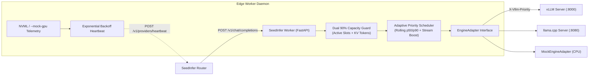

# SeedInfer Worker (`seedinfer-worker`)

[](https://github.com/jakubjasionka/seedinfer-worker/actions/workflows/ci.yml)
[](LICENSE)
[](pyproject.toml)

Autonomous edge GPU worker daemon and adaptive priority proxy for the SeedInfer decentralized inference network. Collects real-time hardware telemetry via NVML (with a hardware-less `--mock-gpu` mode), enforces a dual 90% concurrency/KV-cache safety guard, and adapts across `vLLM`, `llama.cpp`, and simulated CPU engines.

---

## Architecture



### Core Capabilities
- **NVML Telemetry with `--mock-gpu` Fallback:** Queries NVIDIA GPUs via `pynvml` for free/used VRAM, utilization, and thermals, or simulates an RTX 4090 / 5090 profile on CPU-only machines for CI and local testing.
- **Adaptive Rolling-Percentile Priority Scheduling:** Computes per-request priority (`0` = Express Lane, `5` = Standard, `10-15` = Background) from rolling p50/p90 prompt token distributions and applies an interactive streaming boost.
- **Dual 90% Capacity Guard:** Rejects excess traffic with HTTP `429` (`Retry-After: 1`) once active requests or estimated KV-cache tokens reach 90% of hardware capacity, preventing GPU OOM crashes.
- **Exponential Backoff Heartbeat Client:** Automatically reconnects to `seedinfer-router` using bounded exponential backoff with jitter and honors HTTP `429 Retry-After` headers.
- **Multi-Engine Adapters:** Clean `EngineAdapter` abstraction supporting `VllmEngineAdapter` (with `/metrics` KV block auto-detection), `LlamaCppEngineAdapter`, and `MockEngineAdapter`.

---

## Quickstart

### 1. Start with Docker Compose (`--mock-gpu` enabled by default)
```bash
cp .env.example .env
docker compose up --build -d
```

### 2. Query worker health & simulated GPU telemetry
```bash
curl -s http://localhost:3001/health | python3 -m json.tool
```

### 3. Run an OpenAI-compatible inference request through the priority proxy
```bash
curl -s -X POST http://localhost:3001/v1/chat/completions -H "Content-Type: application/json" -d '{"model":"qwen-2.5-7b","messages":[{"role":"user","content":"Hello edge worker!"}],"stream":false}' | python3 -m json.tool
```

### Local CLI & Unit Tests (CPU-only)
```bash
pip install -e ".[dev]"
seedinfer-worker --mock-gpu --engine mock --port 3001
ruff check .
mypy seedinfer_worker tests
pytest -q
```

---

## Benchmarks

Edge worker proxy overhead and priority scheduling latency under synthetic concurrency:

| Workload Profile | Active Slots | Proxy Overhead p50 | Proxy Overhead p99 | Express Lane Priority Boost |
| :--- | :--- | :--- | :--- | :--- |
| Interactive Stream (`<= p50` tokens) | 8 / 32 | 0.6 ms | 1.4 ms | Priority `0` (Express) |
| Long-Context Batch (`> p90` tokens) | 26 / 32 | 0.9 ms | 2.1 ms | Priority `15` (Background) |

*(Placeholder for multi-GPU vLLM NVFP4 / FP8 KV-cache throughput benchmarks.)*

---

## Security

1. **Sanitized Host Telemetry:** Host telemetry reports only sanitized node identifiers (`^[A-Za-z0-9._-]{1,64}$`), OS platform family, CPU core count, and total RAM. Private LAN IPs, hardware serials, and raw machine hostnames are never transmitted.
2. **Token Masking & Placeholders:** Node authentication tokens (`SEEDINFER_NODE_TOKEN`) are never logged in full. `.env.example` contains strictly non-functional placeholder values.
3. **10% Hardware Headroom Reserve:** The dual capacity guard enforces a hard 90% ceiling on both concurrent sequences and KV-cache token allocation to protect host stability.

---

## License

Released under the [MIT License](LICENSE).
